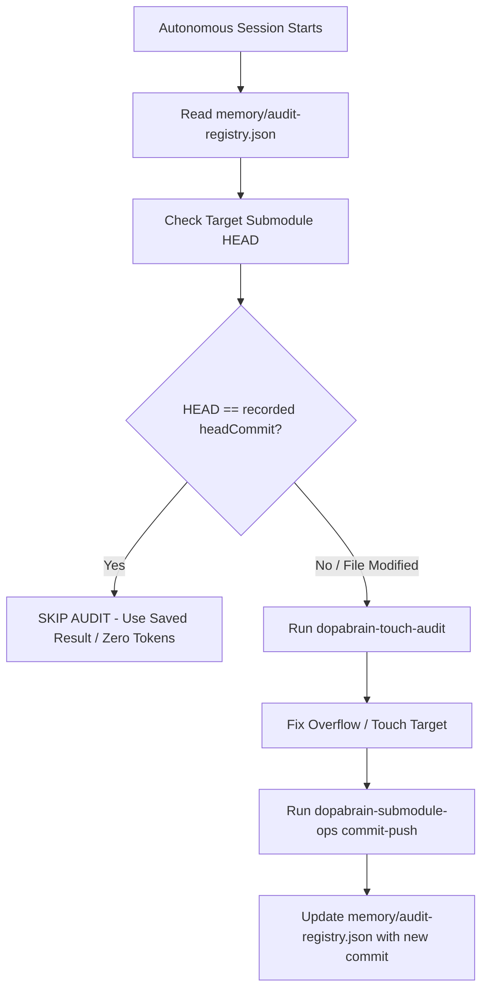

# DopaBrain Completed Audits & Verification Registry

> **Purpose**: Record completed autonomous verifications to eliminate duplicate work and prevent token waste across sessions.  
> **Source of Truth**: [memory/audit-registry.json](file:///e:/Fire%20Project/memory/audit-registry.json)  
> **Rule**: When beginning an autonomous session, an agent MUST NOT re-audit any submodule whose `git rev-parse HEAD` matches the recorded `headCommit` in `memory/audit-registry.json`.

---

## 1. Summary of 119 Audited Submodules (Completed 2026-10-24)

- **Audit Target**: All 119 submodules in `projects/*`.
- **Criteria**:
  - **Mobile Viewport**: `390x844` (Playwright headless Chromium).
  - **Horizontal Overflow**: `0px` (strict).
  - **Touch Targets**: Minimum `44px x 44px` on interactive elements (`a`, `button`, `select`, `input`, `[role="button"]`), with WCAG exceptions for inline prose links, inputs with external labels, and mobile virtual keyboard key widths.
  - **AdSense Contract**: Auto Ads only (0 manual ad units, 0 reward gates).
- **Result**: **100% (119/119) Passed**.
- **Remote Sync**: 100% of child repositories are committed on their tracking branches (`main` or `master`) and pushed to their remote origins. Root pointer updated to `ef75b45`.

---

## 2. Token Saving Protocol for Autonomous Sessions

1. **Before Auditing Any Submodule**:
   - Check if `projects/<submodule>` was modified (`git status --porcelain projects/<submodule>`).
   - If clean, run `git -C projects/<submodule> rev-parse HEAD`.
   - If the hash matches `memory/audit-registry.json`, **DO NOT RUN PLAYWRIGHT AUDIT**. Treat as verified.
2. **When Work Is Required**:
   - Only audit submodules that have had code or CSS modifications.
   - Use `.agents/skills/dopabrain-touch-audit/scripts/audit-touch.js <submodule>`.
   - After committing via `.agents/skills/dopabrain-submodule-ops/scripts/submodule-ops.js`, update `memory/audit-registry.json`.

---

## 3. High-Priority Entry Points (Core Funnels)
These 6 core tools have priority indexing and traffic focus:
1. `projects/stress-check`
2. `projects/hsp-test`
3. `projects/puzzle-2048` (`coach.html`)
4. `projects/brain-type`
5. `projects/iq-test`
6. `projects/portal/tools/kpop-role-roster.html`

All 6 pass 0px overflow and 44px touch target standards.
